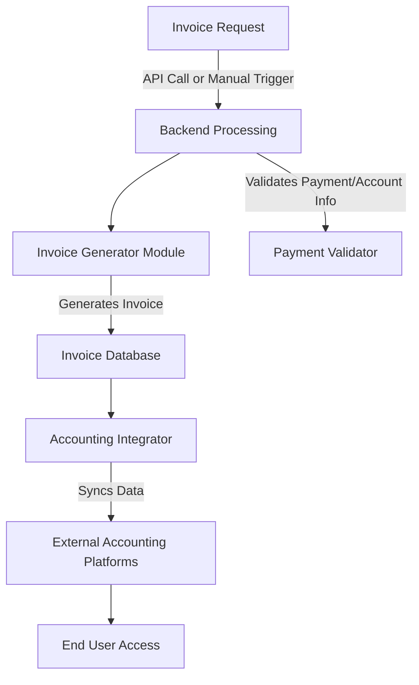

# Invoice Management System    

## Executive Summary
**Invoice** is an elegant Python-based solution for automated invoice creation, management, and tracking, tailored to streamline workflows for small businesses and freelancers. Designed with integration and extensibility in mind, this tool eliminates manual invoicing inefficiencies while empowering users with seamless connections to leading accounting platforms.  

---

## Key Features
- **Automated Invoice Generation**: Create professional-grade invoices with customizable templates.
- **Recurring Invoices**: Automate recurring billing cycles, saving time and reducing errors.
- **Accounting Platform Integrations**: Pre-built connections to platforms like QuickBooks, Xero, and more (extensible for additional systems).
- **Secure Data Management**: Strong encryption ensures invoicing data remains confidential.
- **Robust REST API**: Provides developers with programmatic access to invoice workflows.
- **Multi-Currency Support**: Handle international invoices with ease to accommodate any market.  
- **Error Handling & Logging**: Monitor and troubleshoot issues through descriptive logs.

---

## Architecture & Workflow

This project features a modular architecture prioritizing flexibility, scalability, and integration readiness. Below is the high-level system overview:



---

## Tech Stack & Tools
- **Programming Language**: Python 3.10
- **Backend Framework**: Flask (REST API)
- **Database**: PostgreSQL
- **Encryption**: Fernet (Symmetric Encryption for sensitive data)
- **Third-party Integrations**: QuickBooks, Xero (via SDKs and APIs)
- **Version Control**: Git/GitHub
- **Testing Frameworks**: Pytest, Mock
- **Logging**: Python’s logging module and external log aggregation via Loggly

---

## Quickstart / Installation

Follow these steps to get started:

1. **Clone the Repository**
   ```bash
   git clone https://github.com/EF361/invoice.git
   cd invoice
   ```

2. **Set up a Virtual Environment**
   ```bash
   python3 -m venv venv
   source venv/bin/activate   # On Windows, use `venv\Scripts\activate`
   ```

3. **Install Project Dependencies**
   ```bash
   pip install -r requirements.txt
   ```

4. **Set Environment Variables**  
   Create a `.env` file in the root folder:
   ```
   FLASK_APP=app.py
   FLASK_ENV=development
   DATABASE_URL=your_database_url_here
   SECRET_KEY=your_secret_key_here
   ```

5. **Run the Application**
   ```bash
   flask run
   ```

6. **Access the Application**  
   Open your browser and visit: `http://127.0.0.1:5000`

7. **Run Unit Tests (Optional)**
   ```bash
   pytest
   ```

---

**Contributions & Feedback**  
This repository welcomes contributions and feedback. If you have ideas on further integrations or enhanced utility, feel free to open an issue or submit a pull request. Connect with [Alicia Goh](https://github.com/EF361), the repository maintainer, for any implementation guidance or support.

**License**  
This project is licensed under the MIT License. See the LICENSE file for details.